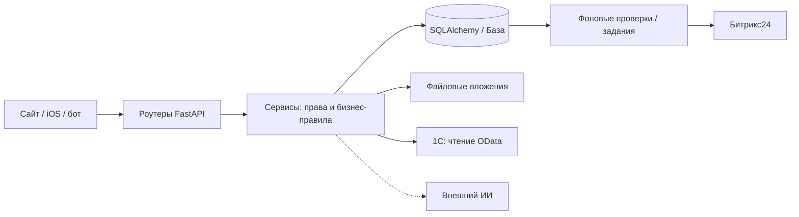
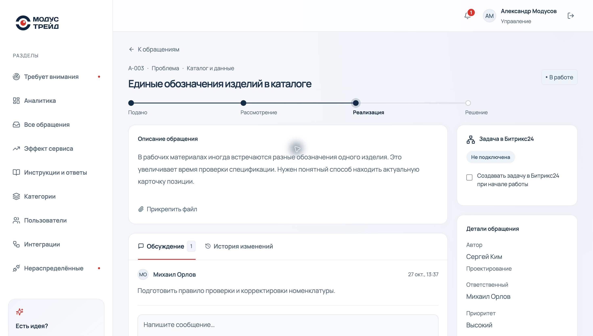
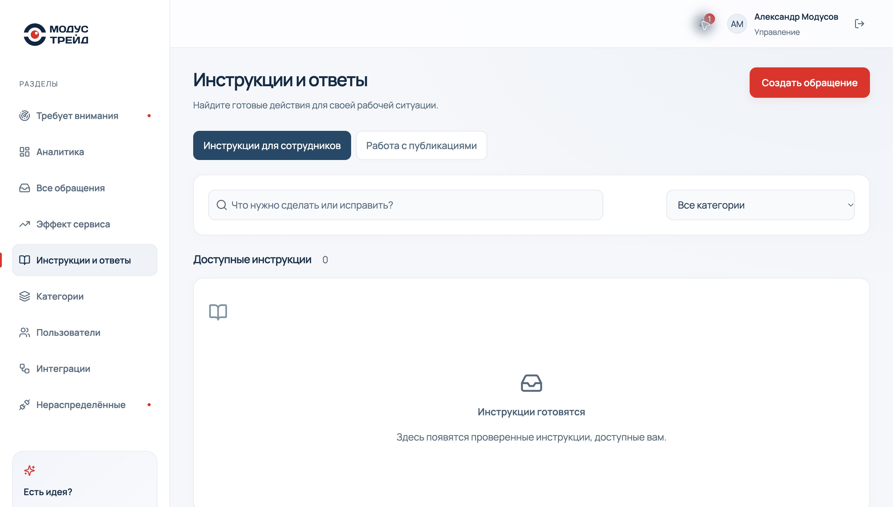
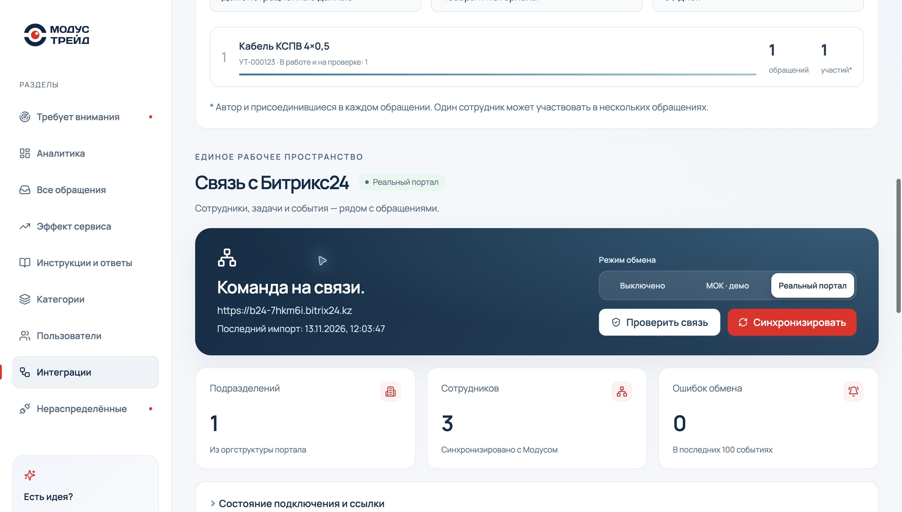
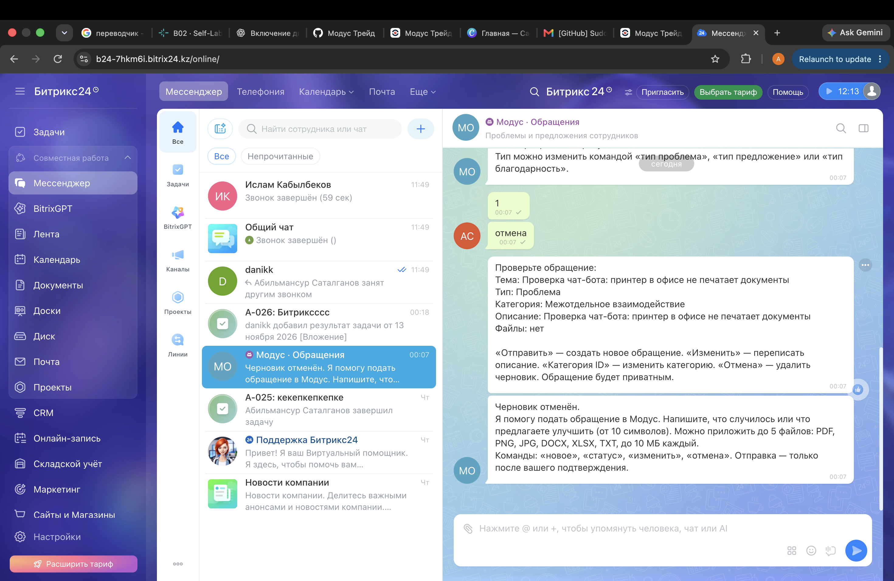
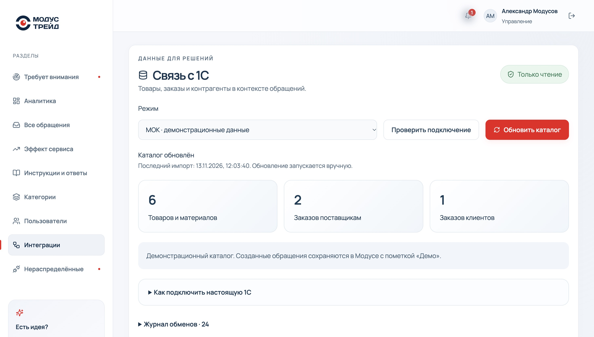
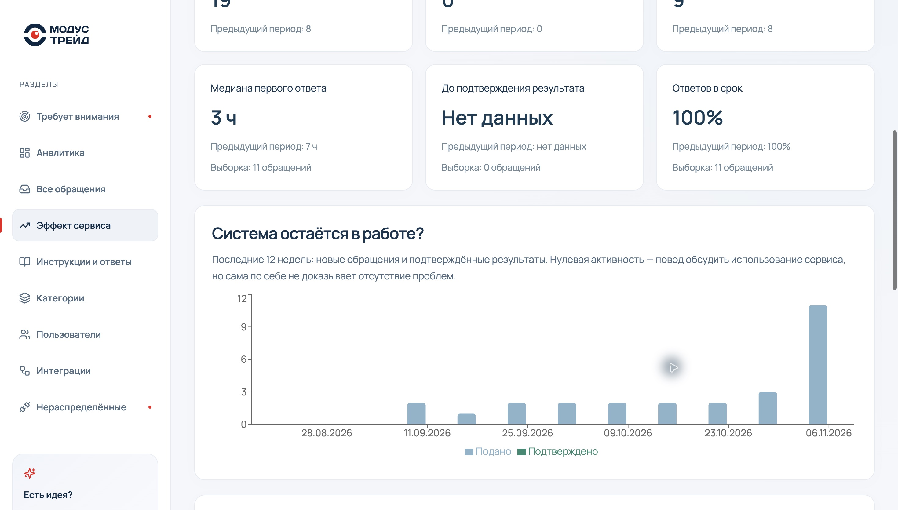
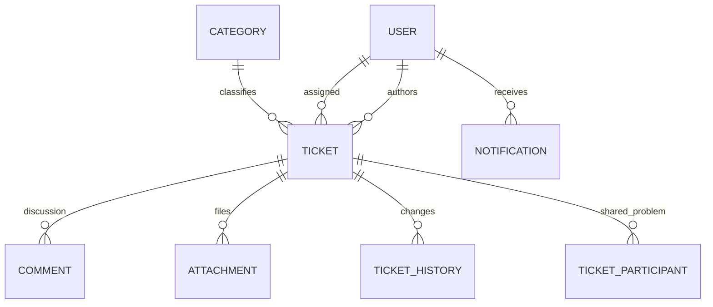
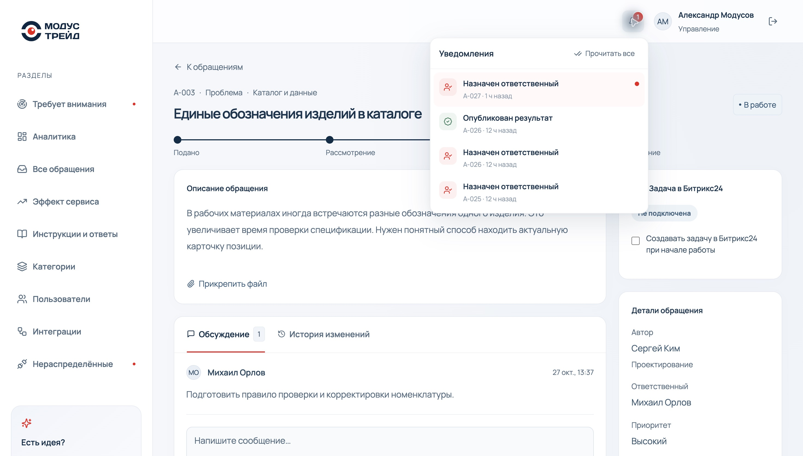

<div align="center">


<br><br>

**API системы обратной связи сотрудников.**<br>Через него работают сайт, iOS-приложение и чат-бот Битрикс24: обращения, права, уведомления, база знаний и живые события.

<br>

**[🌐 Демо](https://modus-trade.makquiz.site)** &nbsp;·&nbsp; **[⭐ Весь проект](https://github.com/Modus-trade/modus)** &nbsp;·&nbsp; **[🎨 Сайт](https://github.com/Modus-trade/modus-front)**

<sub>Python 3.12 · FastAPI · SQLAlchemy 2 · Alembic · PostgreSQL · WebSocket · Битрикс24 REST</sub>

</div>

<br>

## Навигация

- [Назначение и границы](#назначение-и-границы)
- [Запуск у себя](#-запуск-у-себя)
- [Сроки и результат](#-сроки-и-проверка-результата)
- [База знаний](#-база-знаний-инструкции-и-ответы)
- [Структура](#-структура)
- [Основные API](#-основные-эндпоинты)
- [Переменные окружения](#-переменные-окружения)
- [Битрикс24](#-битрикс24)
- [1С](#интеграция-1с)
- [Эффект сервиса](#эффект-сервиса-и-методика-расчёта)
- [Данные и права](#данные-и-права)
- [Эксплуатация](#эксплуатация-и-диагностика)
- [Проверка изменений](#проверка-изменений)

## Назначение и границы

Backend — источник правил для сайта, iOS-клиента и бота Битрикс24. Он хранит обращения, проверяет доступ, назначает сроки, фиксирует историю и уведомления. Внешние адаптеры не заменяют собственный реестр: решение и подтверждение автора сохраняются в Модусе.

README сверено с кодом на **13.11.2026**. Снимки показывают результат работы API в веб-клиенте; это демонстрационные данные. Реальный портал Битрикс24 поддерживается, а настоящая база 1С заказчика пока не подключена. Подбор исполнителя на сайте использует примерные метрики, а не серверную оценку сотрудников.



## 🚀 Запуск у себя

Нужен Python 3.12+. Без `DATABASE_URL` используется локальная SQLite (`app.db`). Перед первым запуском примените миграции и загрузите демо-данные командами ниже.
Самый простой путь — весь проект сразу: [инструкция в modus](https://github.com/Modus-trade/modus#-запуск-у-себя).

**Windows (PowerShell):**

```powershell
py -3.12 -m venv .venv
.\.venv\Scripts\Activate.ps1          # ошибка про сценарии → Set-ExecutionPolicy -Scope CurrentUser RemoteSigned -Force
pip install -r requirements.txt
alembic upgrade head
python seed.py                     # демо-данные, пароль у всех: demo1234
uvicorn app.main:app --port 8000
```

**macOS / Linux:**

```bash
python3 -m venv .venv
source .venv/bin/activate
pip install -r requirements.txt
alembic upgrade head
python seed.py
uvicorn app.main:app --port 8000
```

- Проверка: http://127.0.0.1:8000/api/health → `{"status":"ok"}`
- Документация API (Swagger): http://127.0.0.1:8000/docs
- Сайт из `modus-front` по умолчанию подключается именно сюда.

Тесты: `python -m pytest -q` — тесты используют временную базу и подменённые внешние клиенты; точное число проверок смотрите в выводе pytest.

## ⏱ Сроки и проверка результата

Срок решения задаёт руководитель в карточке обращения. Для существующих обращений он изначально не назначен. Изменение или снятие установленного срока требует причины и сохраняется в истории.

После обновления примените `alembic upgrade head` перед запуском API. Пока API работает, фоновая задача раз в минуту проверяет сроки: напоминает активному исполнителю за 24 часа и уведомляет активных администраторов при просрочке. При запуске также проверяются пропущенные просрочки. Завершённые обращения исключены; ожидание уточнения не приостанавливает срок. Уникальные ключи в базе защищают от повторов при перезапусках и нескольких процессах. Уведомления доступны во внутреннем колокольчике.

После «Реализовано» результат проверяет автор: подтверждение закрывает обращение, возврат с обязательным пояснением переводит его в работу. Проверяется конкретная версия результата; изменённый исполнителем текст требует новой проверки. Решения автора и снимки результатов сохраняются, повторные запросы не создают дублей. При возврате прежний срок решения и срок первого ответа сохраняются; просроченное решение снова попадает в центр внимания и получает уведомление для нового цикла работы. Новый срок оформляется отдельно с причиной. Отклонённые обращения закрываются по прежним правилам. Ранее закрытые обращения автоматически не помечаются подтверждёнными; ранее реализованные обращения с описанным результатом доступны для проверки автором.




*Карточка: единое обращение, обсуждение и контроль работы. Реальный интерфейс Модуса, демонстрационные данные; 13.11.2026.*

## 📚 База знаний «Инструкции и ответы»

Миграции `008` и `009` добавляют инструкции, отдельные черновики, проверку публикации и журнал версий. Перед запуском выполните `alembic upgrade head`. Существующие статьи переводятся в черновики с сохранением текста для повторной проверки. Подготовить новую инструкцию можно в карточке после подтверждения решения автором. Редактор отдельно заполняет название, условия применения и шаги, сохраняет черновик и отправляет его на проверку. Подразделение аудитории определяется автором исходного обращения. Публикацию на всю компанию подтверждает администратор, для своего подразделения — его руководитель или администратор.

Проверка текста отмечает распространённые форматы секретов, контактов, идентификаторов и ссылок. Обнаруженные значения секретов блокируют отправку на проверку, предупреждения требуют явного подтверждения редактором. Материал, отмеченный как персональный или конфиденциальный случай, сохраняется в черновике до подготовки обобщённого текста. Эти проверки дополняют ручную редактуру. Изменение опубликованной инструкции создаёт новый черновик, следующая версия появляется у читателей после проверки. История версий доступна руководителям по правам исходного обращения.

Читатель может сообщить администратору о закрытых данных. Текст сообщения доступен администратору. Редактор может снять публикацию отдельным действием, в том числе при незавершённом черновике. Публикация, снятие статьи и изменение доступа обновляют данные открытых вкладок через WebSocket. Сервер проверяет аудиторию, срок и версию для списка, поиска, чтения, просмотров и обратной связи. Переписка и файлы исходного обращения не включаются в статьи.

Инструкции доступны в разделе «База знаний» и предлагаются при заполнении обращения. Поиск использует слова опубликованного текста с нормализацией русских окончаний. При ошибке поиска отправка обращения остаётся доступной. Срок повторной проверки выбирается при публикации, по умолчанию 90 дней. Просроченные и снятые публикации исключаются из поиска и чтения. Изменение версии требует повторного открытия перед обратной связью.

Показатель в аналитике учитывает попытки с открытием инструкции за последние 30 дней. Успешным считается явное подтверждение «Решил вопрос по инструкции». Повторные просмотры одной формы учитываются один раз. Отправка обращения или присоединение к общей проблеме с тем же идентификатором попытки заменяет её результат. Отсутствие ответа сохраняется как неизвестный исход. Показатель описывает ответы пользователей в пределах одной попытки, связь с последующими независимыми сессиями не устанавливается. Руководитель видит агрегат своего подразделения, администратор — компании.




*Каталог опубликованных инструкций; в этой локальной базе он ещё пуст. Реальный интерфейс Модуса, демонстрационные данные; 13.11.2026.*

## 📂 Структура

```text
app/
  main.py              приложение, подключение роутеров
  models.py            модели SQLAlchemy 2
  schemas.py           валидация Pydantic v2
  security.py          JWT-сессии, пароли, проверка ролей
  realtime.py          WebSocket-хаб; события уходят после коммита
  integration_models.py  модели Битрикс24: настройки, справочник, очередь, бот
  onec_models.py         каталог, настройки и журнал 1С
  routers/             auth, tickets, problems, notifications, analytics, admin,
                       assist (ИИ), knowledge, knowledge_editor,
                       integrations, bitrix_bot, onec
  services/            права и переходы статусов, сроки, проверка результата,
                       центр внимания, уведомления, живые события, ИИ-клиент,
                       база знаний, клиент Битрикс24 и очередь, чат-бот
alembic/versions/      миграции базы
seed.py, dataset.json  демо-данные из датасета заказчика
tests/                 интеграционные тесты API
scripts/deploy.sh      выкладка на сервере (запускает GitHub Actions)
```

## 🔌 Основные эндпоинты

| Метод | Путь | Что делает |
| --- | --- | --- |
| POST | `/api/auth/login`, `/api/auth/logout` · GET `/api/auth/me` | вход, выход, текущий пользователь |
| GET/POST | `/api/tickets` | список с фильтрами и создание обращения |
| GET/PATCH | `/api/tickets/{id}` | карточка, смена статуса, приоритета, ответственного, результата |
| POST | `/api/tickets/{id}/comments`, `/attachments`, `/voice` | комментарий или уточнение, файл, голосовое сообщение (расшифровка приходит фоном) |
| POST | `/api/assist/suggest` | тип и категория по тексту и фото (ИИ или правила) |
| POST | `/api/assist/voice` | голос → тема, описание, тип и категория (нужен ИИ) |
| POST · GET | `/api/problems/{id}/join`, `/api/problems/joined` | присоединиться к общей проблеме, мои присоединения |
| POST | `/api/tickets/{id}/solve` | вариант решения от ИИ для ответственного |
| PATCH · POST | `/api/tickets/{id}/resolution-deadline`, `/resolution-review` | срок решения; подтверждение или возврат результата автором |
| GET · POST | `/api/knowledge`, `/search`, `/suggest`, `/{id}`, `/{id}/feedback`, `/{id}/report` | инструкции: список, поиск, подсказки при подаче, чтение, «помогло», жалоба |
| GET · PUT · POST | `/api/tickets/{id}/knowledge-article`, `/submit`, `/approve`, `/withdraw` | инструкция из решения: черновик, проверка, публикация, снятие |
| GET · PUT · POST | `/api/integrations/bitrix`, `/mode`, `/check`, `/sync`, `/jobs/{id}/retry` | Битрикс24: состояние, режим, проверка связи, импорт, повтор доставки |
| GET · PUT | `/api/integrations/bitrix/tickets/{id}` | связанная задача в Битрикс24 |
| GET · PUT · POST | `/api/integrations/bitrix/bot`, `/register` | чат-бот «Модус · Обращения» |
| GET/POST | `/api/notifications`, `/read-all`, `/{id}/read` | уведомления |
| WS | `/api/ws` | живые события (cookie сайта или токен из `GET /api/ws-token` для приложения) |
| GET | `/api/analytics/summary`, `/api/analytics/attention` | аналитика, центр внимания |
| … | `/api/categories`, `/api/users` | администрирование |

Полный список с параметрами есть в Swagger.

## ⚙️ Переменные окружения

| Переменная | По умолчанию | Назначение |
| --- | --- | --- |
| `DATABASE_URL` | SQLite `app.db` | строка подключения (на сервере PostgreSQL) |
| `JWT_SECRET` | случайный при запуске | задайте, чтобы сессии не сбрасывались при перезапуске |
| `COOKIE_SECURE` | `false` | `true` при HTTPS |
| `ALLOWED_ORIGINS` | локальные адреса | адреса сайта через запятую |
| `AI_URL`, `AI_KEY` | не заданы | ИИ-сервис для подсказок; без них работают правила |
| `AI_TIMEOUT`, `AI_SOLVE_TIMEOUT`, `AI_VOICE_TIMEOUT` | `4`, `25`, `45` | сколько секунд ждать подсказку, решение и разбор голоса |
| `AI_CONNECT_TIMEOUT` | `2.5` | за сколько секунд понять, что ИИ выключен, и перейти на правила |
| `BITRIX_WEBHOOK_URL` | не задан | входящий вебхук портала (права `user`, `department`, `task`, `im`, `imbot`); секрет, только на сервере |
| `BITRIX_BOT_TOKEN` | не задан | случайный секрет чат-бота, 16–40 символов |
| `MODUS_PUBLIC_URL` | `https://modus-trade.makquiz.site` | адрес сайта для ссылок в уведомлениях, задачах и ответах бота |

Пример лежит в `.env.example`. Файлы `.env` и `app.db` в git не попадают, боевая база хранится только на сервере.

## 🔄 Деплой

Пуш в `main` запускает GitHub Actions:
1. тесты;
2. выкладка на сервер, `alembic upgrade head`, перезапуск;
3. проверка `/api/health`;
4. копия кода в `Modus-trade/modus/backend`.

Если тесты падают, сервер не меняется. Статус виден во вкладке **Actions**.

Изменили модели — создайте миграцию: `alembic revision --autogenerate -m "что изменилось"`. На сервере она применится сама.

## 🔗 Битрикс24

| Что | Как работает |
| --- | --- |
| Сотрудники и оргструктура | импорт по кнопке и раз в час, без дублей; связь с существующими аккаунтами вручную |
| Уведомления | назначение, вопрос, комментарий и результат уходят в портал со ссылкой; тексты и личные данные наружу не передаются |
| Задача | одна связанная задача при переходе в работу; защита от повторного создания |
| Результат обратно | результат завершённой задачи переносится в обращение, автор подтверждает или возвращает |
| Чат-бот | `imbot.v2` в режиме опроса: обращение из личного чата, с файлами, категорией и присоединением к общей проблеме |

Режимы `real` / `mock` / `off` выбирает администратор на странице «Интеграции». Настройка, права вебхука и пошаговые проверки: **[BITRIX24.md](BITRIX24.md)**. Секрет вебхука хранится только в `.env` на сервере.




*Управление подключением Битрикс24 в админке. Реальный интерфейс Модуса, демонстрационные данные; 13.11.2026.*

### Доставка событий и бот

Внутреннее уведомление и внешняя доставка — разные записи. Событие Модуса может уже существовать, пока портал временно недоступен. Очередь хранит состояние и повторы; журнал помогает отличить ошибку прав, настройки и сети. Неопределённый результат создания задачи нельзя бездумно повторять: внешняя задача могла уже появиться.

Бот работает через опрос `imbot.v2`, сохраняет состояние диалога и обрабатывает подтверждение отправки. Пользователь должен быть известен системе и сопоставлен с активной учётной записью. Созданное ботом обращение приватное, с отдельной отметкой источника. При поиске похожих проблем не раскрывается приватная переписка.

Поддерживаются описание, выбор типа/категории, изменение черновика, отмена, подтверждение отправки и присоединение к общей проблеме. Вложения проверяются по формату, размеру и адресу источника. Для реального сценария backend должен оставаться запущенным.



*Предоставленный командой диалог бота: проверка черновика и отмена. Реальный интерфейс Модуса, демонстрационные данные; 13.11.2026.*

## Интеграция 1С

В «Интеграциях» доступен независимый блок 1С: режимы **МОК / реальная база / выключено**, проверка подключения, ручное обновление каталога и последние 30 записей журнала. По умолчанию включён демонстрационный каталог: 6 товаров, 2 заказа поставщикам, 1 заказ клиента. Демо не создаёт обращения автоматически и явно отмечено на форме, в карточке и аналитике.

В форме обращения можно выбрать товар по названию/коду/артикулу и заказ по номеру/контрагенту. Сохраняется снимок выбранной записи с `Ref_Key`, источником и временем привязки: обновление или отключение каталога не меняет старое обращение. Обращения с документами приватные, сделать их общими нельзя.

В «Аналитике» и администраторском блоке «Интеграции» есть рейтинг товаров и поставщиков по обращениям типа «Проблема», фильтры источника и периода, переход к связанным обращениям. Поставщики определяются только по заказам поставщикам. Права руководителя ограничивают и рейтинг, и список обращений. «Участий» — сумма автора и присоединившихся в каждом обращении, а не число уникальных людей между обращениями.

### Подключение реальной базы

1. Администратор 1С публикует стандартный OData по HTTPS и выдаёт пользователя с правами чтения нужных коллекций.
2. В серверном `.env` задайте `ONEC_ODATA_URL`, `ONEC_USERNAME`, `ONEC_PASSWORD` (пример в `.env.example`). Секреты не вводятся в браузере и не пишутся в журнал.
3. Сверьте имена коллекций и полей с `$metadata` конфигурации. По умолчанию: `Catalog_Номенклатура`, `Catalog_Контрагенты`, `Document_ЗаказПоставщику`, `Document_ЗаказКлиента`, `Артикул`, `Контрагент_Key`. Для другой конфигурации задайте `ONEC_ENTITY_*` и `ONEC_FIELD_*`. Контракт: GUID `Ref_Key`, у справочников `Description/Code/IsFolder/DeletionMark`, у документов `Number/Date/DeletionMark` и ссылка на контрагента.
4. Перезапустите backend, примените `alembic upgrade head`, выберите «Реальная база», проверьте подключение и обновите каталог. Реальные ошибки не подменяются демо-данными.
5. По умолчанию реальные документы ищут менеджеры и администраторы. `ONEC_ALLOW_EMPLOYEE_DOCUMENTS=true` разрешает всем сотрудникам поиск всех импортированных документов: включайте для специально подготовленной публикации. Доступ к уже созданному обращению определяется правилами Модуса.

Адаптер выполняет только GET, без редиректов; страницы по 200 записей, максимум 20 000 на коллекцию. Читаются необходимые поля без сумм и банковских реквизитов. Четыре коллекции загружаются до изменения кэша: ошибка любой страницы сохраняет прежний каталог. Удалённые записи перестают предлагаться после успешного импорта. Обновление ручное, время видно в интерфейсе.

Настоящая база заказчика пока не подключена. Адаптер проверен тестовым HTTP-транспортом; совместимость конкретной конфигурации нужно проверить на её публикации. Официальное описание: https://v8.1c.ru/platforma/rest-interfeys/

### Сквозная проверка

1. Администратор → «Интеграции» → 1С → «МОК» → «Проверить подключение» → «Обновить каталог». В журнале появляются успешные записи.
2. Сотрудник создаёт **проблему**, выбирает кабель и заказ `ЗП-000101`. В карточке видны позиция и документ с пометкой «Демо».
3. Создайте вторую проблему с теми же привязками. В аналитике по демо-данным у товара и поставщика станет 2 обращения. Нажмите строку рейтинга и откройте обращение.
4. Сотруднику другого подразделения приватная карточка недоступна. Руководитель другого подразделения не видит её в рейтинге, если она ему не назначена.
5. Выключите 1С: каталог пуст, старые привязки сохраняются. Верните «МОК» для следующей проверки.



*Панель 1С: режим, проверка, импорт и счётчики каталога. Реальный интерфейс Модуса, демонстрационные данные; 13.11.2026.*

### API 1С

Короткие пути в таблице дополняются префиксом `/api/integrations/onec`; первая строка показывает полный базовый путь.

| Метод и путь | Назначение | Доступ |
| --- | --- | --- |
| `GET /api/integrations/onec` | Режим, готовность конфигурации, счётчики, журнал | Администратор |
| `PUT /mode` | `mock`, `real`, `off` | Администратор |
| `POST /check` | Проверить чтение источника | Администратор |
| `POST /sync` | Загрузить каталог | Администратор |
| `GET /items?q=...` | Поиск товаров | Авторизованные пользователи |
| `GET /documents?kind=purchase&q=...` | Заказы поставщикам; `sale` — клиентам | С учётом ограничения реальных документов |
| `GET /analytics?mode=mock&group=items&days=90` | Рейтинг товаров; `suppliers` — поставщиков | Руководитель / администратор, по доступным обращениям |
| `GET /analytics?...&key=...&page=1` | Обращения выбранной группы | Те же права, по 20 записей |

Поиск каталога возвращает не больше 100 результатов; уточняйте запрос. Контрагент сохраняется в контексте документа, а не используется для произвольного доступа ко всей учётной базе.

## Эффект сервиса и методика расчёта

`GET /api/analytics/impact?days=30` принимает `30`, `60` или `90`. Доступен руководителю и администратору. Основная реализация — `app/services/impact.py`; исходная выборка ограничивается общими правилами `visible(user)`.

| Поле | Смысл |
| --- | --- |
| `generated_at` | Время расчёта |
| `current_start`, `previous_start` | Начала текущего и предыдущего равного периода |
| `first_record_at`, `comparison_ready` | Начало истории и достаточность её длительности |
| `current`, `previous` | Создания, подтверждения, участники, время и своевременность |
| `response_sample`, `solution_sample` | Число наблюдений, на которых рассчитаны медианы |
| `weeks` | 12 недель наблюдений |
| `backlog`, `stale`, `overdue` | Незавершённые, без обновления 14 дней, с просроченным первым ответом |
| `teams` | Создано / подтверждено за период и текущий остаток по отделам авторов |
| `results` | До 10 последних подтверждённых результатов текущего периода |

Первый ответ включается по дате первого ответа; результат — по дате подтверждения. Длительности считаются от создания обращения. Активные участники — уникальные авторы созданных обращений и комментариев. Нет наблюдений — возвращается `null`, а не ноль часов. Доля своевременных ответов рассчитывается среди уже состоявшихся ответов; неотвеченные просрочки показаны отдельно.

Остаток включает всё, кроме `CLOSED` и `REJECTED`. Это текущий снимок, а не исторический остаток на конец каждого периода. `comparison_ready` проверяет длительность доступной истории, но не доказывает полноту регистрации всех проблем компании. Метрики не доказывают причинный эффект внедрения; данных «до Модуса» в этом endpoint нет.



*Эффект сервиса: значения периодов и размер выборки. Реальный интерфейс Модуса, демонстрационные данные; 13.11.2026.*

## Данные и права

### Основные сущности



Диаграмма показывает основные отношения, а не полную физическую схему. Дополнительно хранятся версии результатов и их проверки, публикации знаний, справочник и очередь Битрикса, состояния диалогов бота, каталог и обмены 1С. Точные столбцы и ограничения — в моделях и Alembic-миграциях.

| Объект | Где искать |
| --- | --- |
| Пользователи, категории, обращения, комментарии, история | `app/models.py` |
| Формат входящих и исходящих данных | `app/schemas.py` и схемы соответствующих роутеров |
| Сессия и роли | `app/security.py` |
| Видимость обращений и переходы | `app/services/tickets.py` |
| Общие проблемы и число участников | `app/services/problems.py` |
| Проверка результата | `app/services/resolution_reviews.py` |
| Сроки и напоминания | `app/services/deadlines.py` |
| Публикации и поиск знаний | `app/services/knowledge.py` |
| Очередь Битрикс24 | `app/services/integrations.py` |
| Диалог бота и поиск общих проблем | `app/services/bitrix_bot.py`, `bot_matching.py` |
| Адаптер 1С и снимки записей | `app/services/onec_client.py`, `onec.py` |

### Правила доступа

- `EMPLOYEE`: собственные или назначенные ему обращения.
- `MANAGER`: обращения авторов из его подразделения либо назначенные ему.
- `ADMIN`: все обращения и административные настройки.
- Присоединение к общей проблеме даёт ограниченное представление; оно не делает участника полноправным читателем приватных данных.
- Назначенный импортированный сотрудник Битрикса может обрабатывать свои обращения без повышения до администратора.
- Неактивные аккаунты и недопустимые исполнители проверяются сервером.
- Файлы скачиваются через защищённый API; наличие ID вложения не является разрешением.

Анонимных опросов и анонимной подачи в текущем API нет. Не описывайте приватность как отсутствие известного системе автора.

### Уведомления и живые события

Сервер сохраняет уведомление, адресата и состояние прочтения. WebSocket сообщает клиенту об изменениях после успешного коммита. Браузер использует cookie сессии; мобильный WebSocket получает отдельный токен через `/api/ws-token`.

Живой канал ускоряет обновление экрана, но не заменяет постоянные записи. После переподключения клиент получает актуальные данные через REST. Мобильное приложение формирует локальные системные уведомления; серверная доставка APNs/FCM пока не реализована.



*Сохранённые уведомления и переход к обращению. Реальный интерфейс Модуса, демонстрационные данные; 13.11.2026.*

## Эксплуатация и диагностика

### Конфигурация и данные

Секреты хранятся только в окружении сервера или игнорируемом `.env`. Не переносите их в README, скриншоты, URL внешних картинок или frontend. `.env.example` содержит шаблоны без действующих ключей. Режимы интеграций хранятся в базе и переключаются администратором: одного наличия вебхука недостаточно, чтобы включить нужный режим.

`MODUS_PUBLIC_URL` должен вести на доступный получателям сайт. `localhost` на компьютере сотрудника означает его собственный компьютер. Локальная база и серверная база не синхронизируются через git: репозиторий переносит код и миграции, но не текущие обращения.

Миграции выполняйте перед запуском новой версии. `seed.py` предназначен для демо, а не для замены рабочей базы. Перед эксплуатационной миграцией нужна проверенная резервная копия базы и вложений. Изменение модели без миграции недостаточно.

### Фоновые процессы

FastAPI lifespan запускает проверку сроков и интеграционный цикл. Сервис должен работать непрерывно для напоминаний, доставки в портал, опроса связанных задач и бота. 1С в текущем MVP обновляется вручную. Настройки расписания Битрикса и логика повторов находятся в сервисе интеграций.

При масштабировании отдельно проверьте модель исполнения фоновых задач и WebSocket-соединений. Наличие защиты от повторов в отдельных операциях не означает готовности произвольного количества серверных процессов без эксплуатационного теста.

### Что означает код ответа

| Ответ / симптом | Проверка |
| --- | --- |
| `401` | Сессия истекла или отсутствует; выполнить вход |
| `403` | Роль, назначение, аудитория публикации или недопустимый Origin |
| `404` для существующего ID | Запись может быть скрыта текущему пользователю |
| `409` | Конкурентное изменение или устаревшая версия результата; обновить карточку |
| `422` | Некорректные поля, переход или параметр; прочитать `detail` |
| `502/503` интеграции | Доступность источника, конфигурация, журнал; не переключать на мок незаметно |
| `/api/health` работает, данные нет | Проверить миграции, доступ к БД и лог конкретного запроса; health не проверяет все внешние сервисы |
| Нет задач Битрикса | Сопоставление исполнителя, право `task`, режим, опция карточки и очередь |
| Нет результата задачи | Завершение задачи, закреплённый результат, работа фонового цикла |
| Пустой каталог 1С | Выбранный режим, успешность импорта, `$metadata`, права публикации |
| При перезапуске разлогинивает | Постоянный `JWT_SECRET` |

### Поставка

Исходный код backend меняется в этом репозитории. После успешных проверок CI выкладывает его на сервер и обновляет зеркало `modus/backend`. Изменения зеркала вручную могут быть перезаписаны. Отдельный push frontend не выкладывает backend и наоборот. Переменные окружения на сервере обновляются отдельно от git.

## Проверка изменений

```sh
# В активированном venv, из корня backend
python -m pytest -q
alembic heads
```

Полезные группы тестов найдите командой `rg --files tests`. При изменении прав проверьте как разрешённый, так и запрещённый доступ. При изменении интеграции проверьте недоступность источника, повторы и сохранение существующих данных. При изменении результата проверьте конкурентное подтверждение старой версии.

Для сквозной проверки: создать обращение сотрудником → запросить уточнение → ответить → опубликовать результат → вернуть с пояснением → исправить → подтвердить автором. Затем проверить историю, уведомления и метрики эффекта. Внешнюю задачу проверяют отдельно в настоящем портале; 1С — отдельно на конкретной публикации.

Ручное демо интеграций с настоящими ключами выполняет реальные действия в портале. Автоматические тесты должны использовать подменённый HTTP-транспорт и отдельную тестовую БД.

- [Полное описание продукта](https://github.com/Modus-trade/modus)
- [Веб-интерфейс и скриншоты](https://github.com/Modus-trade/modus-front)
- [Пошаговая настройка Битрикс24](BITRIX24.md)
- [Шаблон окружения](.env.example)
